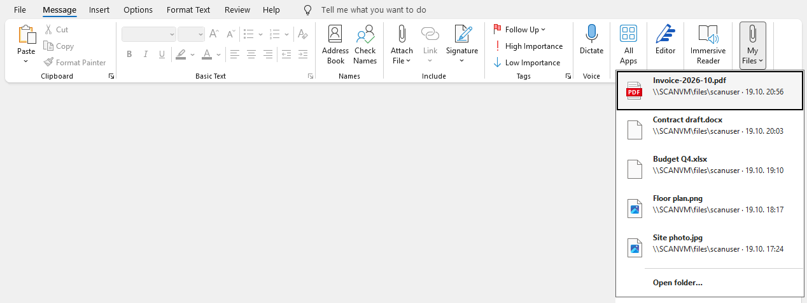

# QuickAttach

Classic Outlook COM add-in that adds a "Recent Files" menu to the compose window and the inline reply.
Like Outlook's Attach File > Recent Items, the menu lists the newest files of a configured (network) folder with
the file type icon, the file name and a second line with folder and time, and attaches the selected file.
`ShowThumbnails=false` hides the icons.

## Projects

| Path                           | Target         | Purpose                                                   |
| ------------------------------ | -------------- | --------------------------------------------------------- |
| `src/QuickAttach.Core`         | netstandard2.0 | Config merge, central config, file listing, version rules |
| `src/QuickAttach`              | net48          | COM add-in shell: ribbon, registry, watcher, file icons   |
| `src/QuickAttach.Updater`      | net48          | Logon updater, installs a newer MSI from the share        |
| `tests/QuickAttach.Core.Tests` | net10.0        | Unit tests for Core                                       |
| `installer/`                   | WiX v6         | Per-user MSI, built on Windows only                       |

## Build

Tools come from `.tool-versions` (mise or asdf). The Yarn scripts wrap `dotnet`:

```sh
yarn install
yarn build      # dotnet build QuickAttach.sln
yarn check      # dotnet format --verify-no-changes
yarn test-unit  # Core unit tests
yarn fix        # dotnet format
```

The net48 projects build on macOS and Linux through `Microsoft.NETFramework.ReferenceAssemblies`, so the solution
contains everything except the installer. The MSI needs Windows:

```cmd
dotnet build installer\QuickAttach.Installer.wixproj -c Release -p:Version=0.1.0
```

CI builds the MSI on every pull request (version `0.0.<run number>`) and attaches it, together with
`deploy/config.example.json` and `deploy/install.cmd`, to each GitHub release.

## Install

Only 64-bit Outlook is supported: the MSI is an x64 package and writes the COM registration to the 64-bit registry
view.

Copy `QuickAttach.msi`, `config.json` and `install.cmd` to a share such as `\\filer01\it$\quickattach\`
(users read, IT writes). Users run `install.cmd`, or a logon script calls it. It skips the install when the same or a
newer version is already installed, and passes the `config.json` next to it as `CONFIGPATH`. No admin rights are
needed. Restart Outlook afterwards.

Direct install with MSI properties:

```cmd
msiexec /i QuickAttach.msi /qn CONFIGPATH="\\filer01\it$\quickattach\config.json"
```

`CONFIGPATH` is stored in `HKCU\Software\abigroup\QuickAttach\ConfigPath` and kept across upgrades. `FOLDERPATH`,
`GROUPLABEL` and `GALLERYLABEL` are optional fallbacks written to `HKCU\Software\abigroup\QuickAttach\Install`.

Updates: copy a newer MSI to `update.MsiPath`. The updater installs it at the next logon, before Outlook starts.
`update.MinVersion` above the installed version disables the menu with "Please install the update".

## Configuration

The add-in reads its settings from a central `config.json`, usually next to the MSI on a share. Its path is stored in
`HKCU\Software\abigroup\QuickAttach\ConfigPath`, which the MSI sets from the `CONFIGPATH` property and keeps across
upgrades. Example (`deploy/config.example.json` is a template):

```json
{
  "defaults": {
    "FolderPath": "\\\\SCANVM\\files\\%USERNAME%",
    "GroupLabel": "Documents",
    "GalleryLabel": "My Files",
    "MaxItems": 8,
    "FileFilter": "*.pdf;*.docx;*.xlsx;*.jpg;*.png",
    "AllowUserOverride": false
  },
  "users": {
    "jdoe": { "FolderPath": "\\\\filer01\\files\\accounting" }
  },
  "update": {
    "MsiPath": "\\\\filer01\\it$\\quickattach\\QuickAttach.msi",
    "MinVersion": "0.1.0"
  }
}
```

This configuration produces:



| Value               | Default                                          | Meaning                                                                 |
| ------------------- | ------------------------------------------------ | ----------------------------------------------------------------------- |
| `FolderPath`        | (empty)                                          | Folder to list; environment variables such as `%USERNAME%` are expanded |
| `AdditionalPaths`   | (none)                                           | More folders, `;`-separated or a JSON array                             |
| `GroupLabel`        | `Quick Attach`                                   | Ribbon group label                                                      |
| `GalleryLabel`      | `Recent Files`                                   | Menu button label                                                       |
| `GalleryScreentip`  | `Attach recent files from the configured folder` | Menu button tooltip                                                     |
| `TargetTab`         | `Message`                                        | `Message` or `Insert`; read only when Outlook starts                    |
| `MaxItems`          | `10`                                             | Number of files, 1 to 30                                                |
| `MaxAgeDays`        | `0`                                              | Hide older files; 0 shows all                                           |
| `FileFilter`        | `*.pdf;*.jpg;*.png;*.tif`                        | File patterns                                                           |
| `ShowThumbnails`    | `true`                                           | Show file type icons                                                    |
| `AllowUserOverride` | `false`                                          | Enables "Settings…" and the user layer below                            |

Each value is taken from the first source that sets it, highest priority first:

| Priority | Source                                                                                   |
| -------- | ---------------------------------------------------------------------------------------- |
| 1        | Policy: `HKCU\Software\Policies\abigroup\QuickAttach`                                    |
| 2        | User override: `HKCU\Software\abigroup\QuickAttach\User` (only with `AllowUserOverride`) |
| 3        | Central `config.json`: `users[<USERNAME>]`                                               |
| 4        | Central `config.json`: `defaults`                                                        |
| 5        | MSI properties: `HKCU\Software\abigroup\QuickAttach\Install`                             |
| 6        | Built-in defaults                                                                        |

MSI properties:

| Property       | Effect                                                                    |
| -------------- | ------------------------------------------------------------------------- |
| `CONFIGPATH`   | Path of the central `config.json`, stored as `...\QuickAttach\ConfigPath` |
| `FOLDERPATH`   | Fallback `FolderPath`, stored under `...\QuickAttach\Install`             |
| `GROUPLABEL`   | Fallback `GroupLabel`, stored under `...\QuickAttach\Install`             |
| `GALLERYLABEL` | Fallback `GalleryLabel`, stored under `...\QuickAttach\Install`           |

The last good `config.json` is cached in `%LocalAppData%\abigroup\QuickAttach\config.cache.json` and used when the
share is not reachable. Labels update without a restart: `config.json` is polled every 60 s and the HKCU keys are
watched. Folder, filter and limits are read every time the menu opens.

## Troubleshooting

- Log file: `%LocalAppData%\abigroup\QuickAttach\log.txt` (add-in and updater).
- Add-in disabled by Outlook: check `LoadBehavior` (3) under `HKCU\Software\Microsoft\Office\Outlook\Addins\Abigroup.QuickAttach`.
  The add-in rewrites `DoNotDisableAddinList` at every start.
